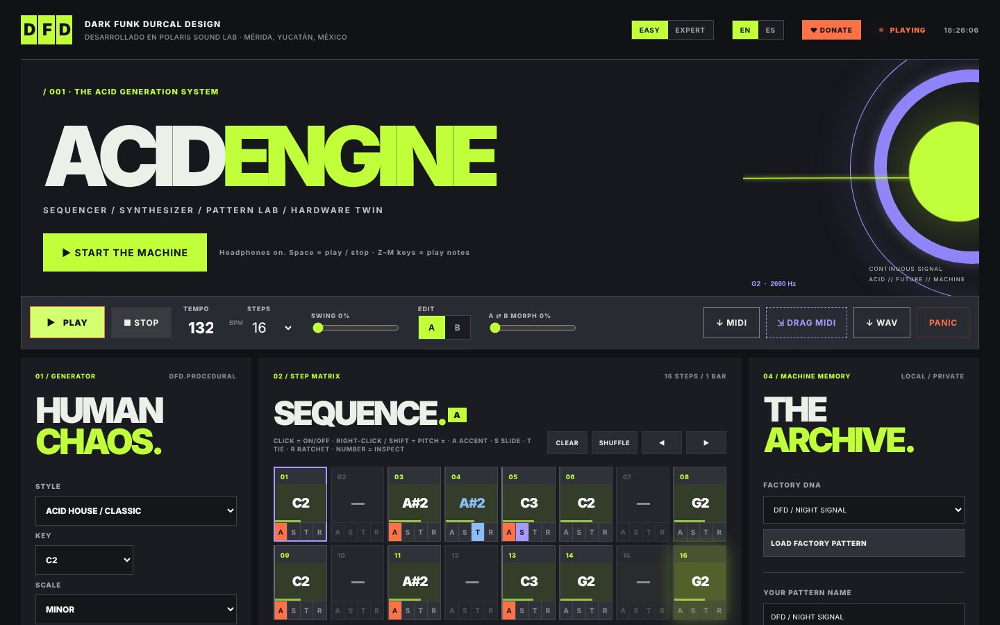
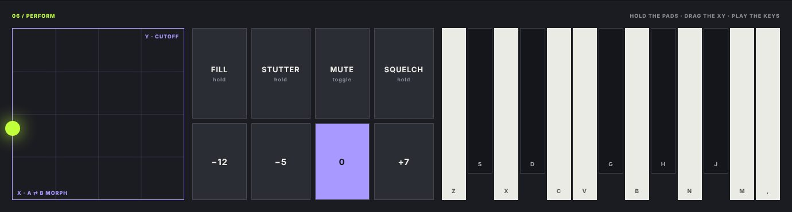
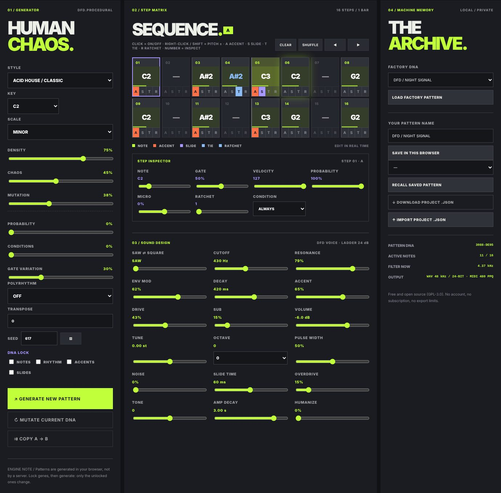
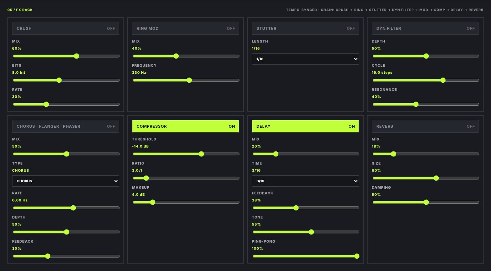
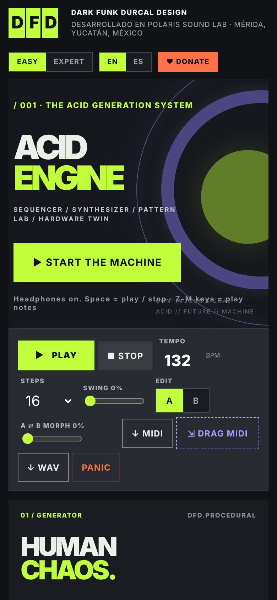

<p align="center"><a href="https://drophlex.github.io/DFD-ACID-ENGINE/"></a></p>

<h1 align="center">DFD / ACID ENGINE</h1>
<p align="center"><b>The acid generation system</b><br>
Acid house · acid techno · filter house · big beat · rave · braindance · electro · deep hypnotic<br>
<i>Free · open source · original engine · made to play live</i></p>

<p align="center">
<a href="https://drophlex.github.io/DFD-ACID-ENGINE/web/"></a>
<a href="https://drophlex.github.io/DFD-ACID-ENGINE/DFD_ACID_ENGINE_OFFLINE.html"></a>


</p>
<p align="center">
<a href="https://drophlex.github.io/DFD-ACID-ENGINE/"><b>🌐 Website</b></a> ·
<a href="manual/DFD-ACID-ENGINE-Web-Manual-EN.pdf"><b>📗 Manual (English)</b></a> · <a href="manual/DFD-ACID-ENGINE-Web-Manual-ES.pdf"><b>📕 Manual (Español)</b></a> · <a href="manual/DFD-ACID-ENGINE-Web-Manual-EN-ES.pdf"><b>English + Español</b></a> ·
<a href="CHANGELOG.md"><b>📝 Changelog</b></a> ·
<a href="docs/STATUS.md"><b>📋 Status</b></a> ·
<a href="https://www.paypal.com/donate/?business=drophlex%40gmail.com&currency_code=MXN"><b>♥ Donate</b></a> ·
<a href="#español"><b>Español</b></a>
</p>

Everything comes **in English**, with a button to switch to **Spanish**: the web (**ES**, top right) and the website (**ES**, top right). The **manual** (17 pages: 5-minute start, every panel, Ableton Live, TB-3, troubleshooting, recipes) comes in English, Spanish, or both.

---

## ✨ What's inside

| | |
|---|---|
| ◉ **A generator that grooves** | 8 styles. Every line starts on the root, repeats like a real riff and turns around at the end of the bar. The generator tries 16 versions and keeps the most usable one. |
| 🧬 **DNA lock** | Keep the notes, the rhythm, the accents or the slides you like and regenerate the rest. Same seed = same pattern, always. |
| ⚡ **A real acid voice** | Band-limited saw ⇄ square, sub, noise, a 4-pole resonant ladder filter with bass compensation, accent build-up, glide, two drive stages, up to 4× oversampling. |
| ▦ **Deep sequencer** | Up to 256 steps: accent, slide, tie, gate, velocity, ratchets, probability, conditions (FILL, 1ST, 1:2 …), micro-timing, swing. Patterns **A / B** with a morph. |
| ✦ **8 tempo-synced FX** | Bit crush, ring mod, stutter, dynamic filter, chorus / flanger / phaser, compressor, ping-pong delay, reverb. |
| ◬ **Live** | XY pad (morph × cutoff), FILL / STUTTER / MUTE / SQUELCH pads, transpose, playable keys (`Z`…`M`), **EASY** and **EXPERT** layers, undo (`Ctrl/⌘+Z`). |
| ⇢ **Into your DAW** | `.mid` export (what you hear is what you get), **drag MIDI** into Ableton, WAV 48 kHz / 24-bit and stems. |
| ⧉ **TB-3 TWIN LINK** | USB MIDI with the official MIDI implementation only: TWIN / HARDWARE / VIRTUAL modes, Shadow Capture, backup and restore of the active patch (always asks first). |

## ⚡ Quick guide

### 🌐 In the browser (computer or phone)



1. Open **[▶ PLAY NOW](https://drophlex.github.io/DFD-ACID-ENGINE/web/)** and press **▶ START THE MACHINE** (headphones on). **ES** = Spanish.
2. Pick a **STYLE** and a **KEY** → **↗ GENERATE**. Don't like it? Generate again.
3. Move **CUTOFF**, **RESONANCE** and **ENV MOD**: that's the squelch.
4. Like the notes? Tick **DNA LOCK · NOTES** and generate a new rhythm.
5. **⇲ DRAG MIDI** into Ableton, or **↓ WAV**. `Space` = play / stop.

<br clear="right">

### ⧉ With a Roland TB-3 (optional)

1. TB-3 → computer with a USB **data** cable. Use **Chrome** or **Edge**.
2. **CONNECT USB MIDI** → allow MIDI (and SysEx, if you want the librarian).
3. **TWIN LINK = TWIN**: the sequencer plays the web synth and the TB-3 together. **HARDWARE**: only the TB-3. **VIRTUAL**: the TB-3 plays the web synth.
4. No TB-3? Tick **DEMO** and try everything with a simulated one.

USB MIDI is not USB audio: record the TB-3's sound through your audio interface or DAW.

### 🎹 Plugin · 🎛 FM-1

Both are **in development** on the same engine (`engine/dfd_acid.h`). They will appear here only once they are built, validated and tested on real hardware.

## 📸 Pictures

<p align="center">

</p>
<p align="center">


</p>

## 🧱 How it's built

```
engine/dfd_acid.h     the whole instrument in one header-only C++17 file: voice, filter, FX, sequencer
engine/wasm.cpp       the engine as WebAssembly (24 KB) for the page, the AudioWorklet and offline render
web/                  the page: index.html, main.js, engine.js, pattern.js (generator), tb3-midi.js, i18n.js
tests/                engine_test.cpp (30 native checks), pattern.test.mjs (11), e2e/smoke.py (browser)
vst3/  fm1/           the plugin and FM-1 code (in development)
docs/handoff/         the original brief and documentation
```

Build and test:

```sh
./tools/build_wasm.sh                      # engine -> web/dfd-wasm.js (needs clang with wasm32)
c++ -std=c++17 -O2 tests/engine_test.cpp -o build/engine_test && ./build/engine_test
node --test tests/pattern.test.mjs
python3 build_offline.py                   # DFD_ACID_ENGINE_OFFLINE.html
python3 -m http.server 8811 && python3 tests/e2e/smoke.py http://localhost:8811/web/
```

## ♥ Support

Free forever. If it makes your track better: **[donate with PayPal](https://www.paypal.com/donate/?business=drophlex%40gmail.com&currency_code=MXN)**.
Instagram **[@polaris.sound.lab](https://www.instagram.com/polaris.sound.lab/)** · YouTube **[@PolarisSoundLab](https://www.youtube.com/@PolarisSoundLab)**

---

## Español

Todo viene **en inglés** con un botón para pasarlo a **español**: la web (**ES**, arriba a la derecha) y el sitio (**ES**, arriba a la derecha). Los manuales vienen en inglés y en español.

### ✨ Qué hay adentro

| | |
|---|---|
| ◉ **Un generador con groove** | 8 estilos. Cada línea empieza en la tónica, se repite como un riff real y da la vuelta al final del compás. El generador prueba 16 versiones y se queda con la más usable. |
| 🧬 **Bloqueo de ADN** | Conserva las notas, el ritmo, los acentos o los slides que te gustan y regenera lo demás. Misma semilla = mismo patrón, siempre. |
| ⚡ **Una voz acid de verdad** | Sierra ⇄ cuadrada sin aliasing, sub, ruido, filtro ladder resonante de 4 polos con compensación de graves, acentos que se acumulan, glide, dos etapas de distorsión, sobremuestreo hasta 4×. |
| ▦ **Secuenciador profundo** | Hasta 256 pasos: acento, slide, ligadura, gate, velocidad, ratchets, probabilidad, condiciones (FILL, 1ST, 1:2 …), micro-timing, swing. Patrones **A / B** con morph. |
| ✦ **8 efectos sincronizados** | Bit crush, ring mod, stutter, filtro dinámico, chorus / flanger / phaser, compresor, delay ping-pong, reverb. |
| ◬ **En vivo** | Pad XY (morph × corte), pads FILL / STUTTER / MUTE / SQUELCH, transposición, teclas (`Z`…`M`), capas **FÁCIL** y **EXPERTO**, deshacer (`Ctrl/⌘+Z`). |
| ⇢ **A tu DAW** | Exporta `.mid` (lo que oyes es lo que obtienes), **arrastra el MIDI** a Ableton, WAV 48 kHz / 24 bits y stems. |
| ⧉ **TB-3 TWIN LINK** | USB MIDI solo con la implementación MIDI oficial: modos TWIN / HARDWARE / VIRTUAL, Shadow Capture, respaldo y restauración del patch activo (siempre pregunta antes). |

### ⚡ Guía rápida

1. Abre **[▶ TOCAR AHORA](https://drophlex.github.io/DFD-ACID-ENGINE/web/)** y presiona **▶ START THE MACHINE** (con audífonos). **ES** = español.
2. Elige un **ESTILO** y un **TONO** → **↗ GENERAR**. ¿No te gusta? Genera otra vez.
3. Mueve **CORTE**, **RESONANCIA** y **ENV MOD**: ese es el squelch.
4. ¿Te gustan las notas? Marca **BLOQUEO DE ADN · NOTAS** y genera un ritmo nuevo.
5. **⇲ ARRASTRA MIDI** a Ableton, o **↓ WAV**. `Espacio` = play / stop.

**Con una TB-3:** cable USB de **datos**, **Chrome** o **Edge**, **CONECTAR USB MIDI**, y **TWIN LINK = TWIN**. ¿Sin TB-3? Marca **DEMO**. USB MIDI no es audio USB: graba el sonido de la TB-3 con tu interfaz o tu DAW.

**Manual:** [español](manual/DFD-ACID-ENGINE-Web-Manual-ES.pdf) · [inglés](manual/DFD-ACID-ENGINE-Web-Manual-EN.pdf) · [los dos](manual/DFD-ACID-ENGINE-Web-Manual-EN-ES.pdf), 17 páginas: inicio en 5 minutos, cada panel, Ableton Live, TB-3, problemas y recetas.

**Plugin y FM-1:** en desarrollo sobre el mismo motor. Se publican aquí solo cuando estén compilados, validados y probados en hardware real.

**Apoya:** gratis para siempre. **[Dona con PayPal](https://www.paypal.com/donate/?business=drophlex%40gmail.com&currency_code=MXN)** · Instagram **[@polaris.sound.lab](https://www.instagram.com/polaris.sound.lab/)** · YouTube **[@PolarisSoundLab](https://www.youtube.com/@PolarisSoundLab)**

---

<p align="center"><b>DARK FUNK DURCAL DESIGN · DESARROLLADO EN POLARIS SOUND LAB · MÉRIDA, YUCATÁN, MÉXICO</b><br>
GPL-3.0 · Independent software, not affiliated with Roland. TB-3 is a trademark of its owner.</p>
